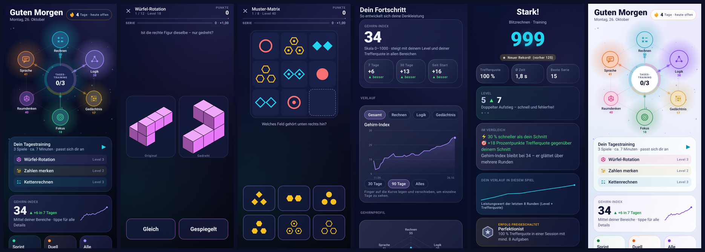

# Synapse – Gehirnjogging ohne Werbung

Kostenlose Android-App für Kopfrechnen, Logik, Gedächtnis, Fokus, Raumdenken und Sprache.
**Keine Werbung, kein Abo, kein Konto – und keine Internet-Berechtigung.** Alles läuft offline,
alle Daten bleiben auf dem Handy.



## Was drin ist

### 15 Spiele in 6 Bereichen

| Bereich | Spiele |
|---|---|
| Rechnen | Blitzrechnen · Kettenrechnen · Zielzahl |
| Logik | Zahlenfolgen · Muster-Matrix · Schlussfolgern · Waage |
| Gedächtnis | N-Back (bis Dual 4-Back) · Corsi-Pfad · Zahlen merken |
| Fokus | Farbwort (Stroop) · Schulte-Tabelle |
| Raumdenken | Würfel-Rotation (3D, gleich oder gespiegelt?) |
| Sprache | Wortsalat · Was passt nicht? |

Jedes Spiel hat **50 unsichtbare Level**. Nach jeder Runde passt sich die Schwierigkeit an:
ab 85 % Trefferquote geht es hoch (bei Tempo + 100 % sogar doppelt), unter 60 % runter.
So bleibst du dort, wo das Training am meisten bringt.

Alle Aufgaben werden vom Programm erzeugt: Sie gehen nie aus und brauchen keine Downloads.

### Oberfläche
- **Neuronen-Netz als Startbildschirm**: Jeder Bereich ist ein leuchtender Knoten.
  Je mehr du trainierst, desto heller leuchtet er und desto mehr Impulse fließen.
  Vernachlässigte Bereiche dimmen langsam ab.
- **Tagestraining-Ring** in der Mitte: 3 (oder 5) Spiele. Bevorzugt kommen Bereiche dran,
  die länger nicht trainiert wurden.
- **Flow-Anzeige**: Mit jeder richtigen Antwort in Folge steigen Multiplikator,
  Leuchten und Tonhöhe.
- Partikel bei richtigen Antworten, sanftes Wackeln bei Fehlern, Vibration und selbst erzeugte Klänge.
- Modi: **Training**, **Sprint** (60 Sekunden) und **Zen** (ohne Zeitdruck).
- **Duell**: zu zweit an einem Handy, geteilter Bildschirm.
- Dunkles und helles Design.

### Fortschritt & Leistungsfähigkeit
- **Gehirn-Index** (0–1000) mit Veränderung über 7 Tage, 30 Tage und seit Start
- **Verlaufskurve** gesamt oder pro Bereich. Finger auf die Kurve legen zeigt den Wert eines Tages.
- **Gehirnprofil** als Netzdiagramm: jetzt im Vergleich zu vor 30 Tagen
- **Wochenvergleich**: Sessions, Minuten, Trefferquote und Index-Zuwachs gegenüber der Vorwoche
- **Trainingskalender** (Heatmap über 18 Wochen)
- **Highlights**: größter Aufstieg, „schneller geworden“, längste Serie
- **Pro Spiel**: Level-Verlauf, Trefferquote, Antwortzeit und die letzten 20 Runden
- **Nach jeder Runde**: Levelwechsel, Vergleich mit deinem Schnitt („17 % schneller“), Rekorde
- 26 **Erfolge** mit Fortschrittsbalken; **Serie** mit einem Joker-Tag pro Woche

### Extras
- Startbildschirm-Widget „Aufgabe des Tages“
- Tägliche Erinnerung (optional, nur wenn du an dem Tag noch nicht trainiert hast)
- Backup als JSON-Datei exportieren und importieren (z. B. für ein neues Handy)

## APK bekommen

Bei jedem Push, der etwas unter `Synapse/` ändert, baut GitHub Actions automatisch die APK.
1. Auf GitHub → **Actions** → **Build Synapse APK** → den letzten Lauf öffnen
2. Unten bei **Artifacts** die Datei `Synapse-APK` herunterladen und entpacken
3. `app-release.apk` auf dem Handy installieren (Installation aus unbekannten Quellen erlauben)

Die APK ist immer mit demselben Schlüssel signiert (`app/synapse-debug.keystore`).
Neue Versionen lassen sich deshalb einfach **über die alte installieren**, ohne dass der Fortschritt verloren geht.

## Selbst bauen

```bash
cd Synapse
./gradlew testDebugUnitTest   # 27 Tests für Generatoren, Statistik, Serien & Erfolge
./gradlew assembleRelease     # APK: app/build/outputs/apk/release/app-release.apk
```

Technik: Kotlin 2.0, Jetpack Compose (Material 3), SQLite, Gradle 8.9 (Wrapper liegt bei), minSdk 29.

## Ehrlicher Hinweis

Gehirntraining macht dich vor allem in den geübten Aufgaben besser. Ob das auf den Alltag übertragbar ist,
ist wissenschaftlich umstritten. Was nachweislich hilft: Abwechslung, Aufgaben am Rand des eigenen Könnens,
Regelmäßigkeit – sowie Schlaf und Bewegung. Deshalb setzt die App auf viele verschiedene Spiele
und verspricht kein „Gehirnalter“.
